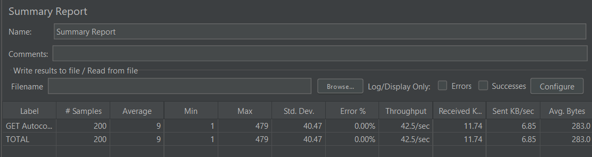
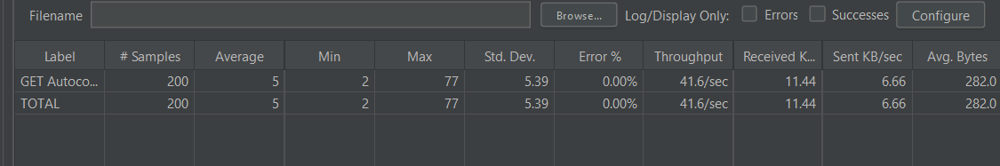

# Autocomplete Search System - Performance Report

## Objective

Design and simulate an autocomplete search system using Spring Boot, a Trie for prefix matching, Redis caching for repeated prefixes, Docker for Redis deployment, and JMeter for concurrent-load testing.

## Architecture

```text
Client (Browser / Postman / JMeter)
                |
                v
Spring Boot REST API: GET /api/autocomplete
                |
                v
       Is the prefix result in Redis?
          |                    |
        Yes                    No
          |                    |
          v                    v
 Return cached list      Search the Trie
                               |
                               v
                  Collect prefix-matching terms
                               |
                               v
                 Rank terms by descending frequency
                               |
                               v
                 Store top-K result in Redis, then return it
```

### Main components

- **Dataset:** `search-terms.csv` contains 500 cleaned, historical AOL-derived search queries and their occurrence counts.
- **Trie:** Built in memory when Spring Boot starts. Each term is inserted character by character. A prefix such as `g` navigates only to the `g` branch, then all complete terms below that node are collected.
- **Top-K ranking:** Matching terms are sorted by their stored frequency in descending order. The API returns only the requested number of suggestions.
- **Redis:** Caches a prefix-and-limit combination for five minutes. Repeated requests can return the saved JSON suggestions without searching the Trie again.
- **REST endpoint:** `GET /api/autocomplete?prefix=g&limit=2&useCache=true`.

## Test configuration

JMeter used the following workload:

| Setting | Value |
|---|---:|
| Threads (concurrent users) | 20 |
| Ramp-up period | 5 seconds |
| Loop count per thread | 10 |
| Total HTTP requests | 200 |
| Prefix | `g` |
| Suggestion limit | 2 |

Two runs were performed:

1. **Trie-only baseline:** `useCache=false`. Redis read/write operations are bypassed, so every request performs the Trie search and top-K ranking.
2. **Redis-cached run:** `useCache=true`. The prefix was warmed once before the JMeter run, allowing repeated requests to use Redis.

## Results

| Metric | Trie-only (without cache) | Redis-cached (with cache) | Observation |
|---|---:|---:|---|
| Samples | 200 | 200 | Identical workload |
| Average response time | 9 ms | 5 ms | 44.4% lower with caching |
| Minimum response time | 1 ms | 2 ms | Both are low |
| Maximum response time | 479 ms | 77 ms | 83.9% lower with caching |
| Standard deviation | 40.47 ms | 5.39 ms | Cached requests are more consistent |
| Error rate | 0.00% | 0.00% | No failed requests |
| Throughput | 42.5 requests/sec | 41.6 requests/sec | Approximately similar in this short GUI run |

### Result screenshots

#### Trie-only baseline



#### Redis-cached run



## Interpretation

Redis caching improved response latency for frequently requested prefixes. Average latency decreased from 9 ms to 5 ms, while the worst recorded latency decreased from 479 ms to 77 ms. The cached run also had a much smaller standard deviation, indicating more predictable response times under concurrent requests.

The cached test did not show higher throughput in this particular short JMeter GUI run: it measured 41.6 requests/sec compared with 42.5 requests/sec for the baseline. This small difference should not be interpreted as a caching regression; throughput is sensitive to short test duration, local-machine scheduling, and JMeter GUI overhead. The lower average and maximum response times provide the stronger evidence of the cache benefit.

## Conclusion

The system satisfies the autocomplete design goal: the Trie efficiently finds terms beginning with a requested prefix, frequencies determine the top-K order, and Redis avoids repeated Trie traversal and sorting for popular prefixes. The JMeter results demonstrate that caching improves average latency and substantially reduces response-time variability while maintaining zero errors under concurrent load.

## Dataset source

The vocabulary is a cleaned deterministic random subset of a published AOL English-query subset from the CMU web09-bst project. The source query-occurrence count is used as the `frequency` field. The source and preprocessing notes are documented in `autocomplete/DATASET_SOURCE.md`.

Source: https://boston.lti.cs.cmu.edu/Data/web08-bst/planning.html
